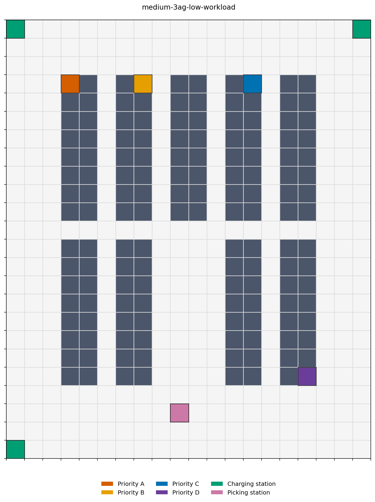
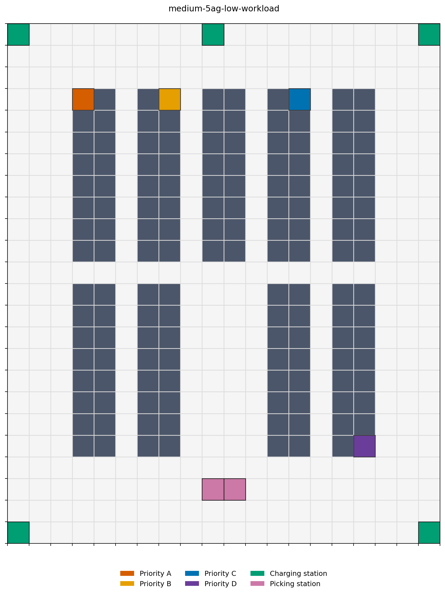
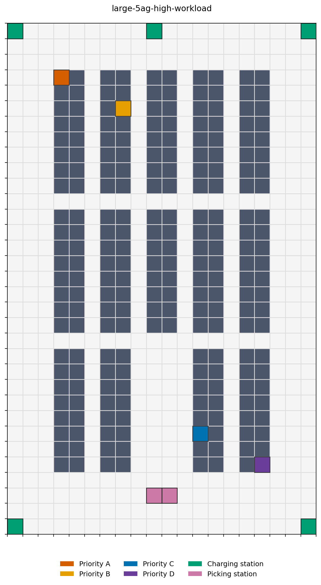

# Phase 1 地图与负载提案

本提案只用于 Phase 1 本地诊断，不是正式训练合同。它基于当前 RWARE
参数布局，并经由 `scripts/preview_phase1_layouts.py` 的可达性检查生成。

## 审计结论

| 基础地图 | 尺寸（宽 × 高） | 可通行格 | 连通性 | 原 RWARE 目标格 |
| --- | ---: | ---: | --- | --- |
| medium | 20 × 24 | 336 | 全部连通 | `(9, 21)`, `(10, 21)` |
| large | 20 × 33 | 436 | 全部连通 | `(9, 30)`, `(10, 30)` |

所有提议的充电站与拣选站都处于可通行格、互不重叠，且与其余可通行区域相连。

## 拟议环境配置

| Profile | AGV | 充电站 | 拣选站 | 初始队列 | 动态入库 | 完成目标 |
| --- | ---: | --- | --- | ---: | --- | ---: |
| `medium-3ag-low-workload` | 3 | `(0,0)`, `(19,0)`, `(0,23)` | `(9,21)` | 3 | 每 120 步加入 1 个任务 | 6 |
| `medium-5ag-low-workload` | 5 | `(0,0)`, `(19,0)`, `(0,23)`, `(19,23)`, `(9,0)` | `(9,21)`, `(10,21)` | 5 | 每 120 步加入 1 个任务 | 8 |
| `large-5ag-high-workload` | 5 | `(0,0)`, `(19,0)`, `(0,32)`, `(19,32)`, `(9,0)` | `(9,30)`, `(10,30)` | 5 | 待后续诊断决定 | 待后续诊断决定 |

所有 profile 均使用：最大 episode 长度 500 步、`A/B/C/D` 任务优先级循环、
`battery_cost_scale=1.10`、`charge_threshold=0.30`、
`charge_release_threshold=0.80`。

“低负载”保持少量并发任务且每 120 步只补充一个任务。large-5AG 的任务到达
节奏、单次批量和完成目标将在 medium-5AG 诊断结果出来后再确定；本提案不提前
冻结其负载强度。

## 颜色约定

- 优先级 A：红橙色；B：琥珀色；C：蓝色；D：紫色。
- 同一优先级的货物完全使用同一种颜色；预览图例仅展示 A/B/C/D 四个优先级类别，
  不显示任务 ID、货架 ID 或 `A1` 等单货物标识。
- 充电站为绿色，拣选站为粉紫色；其余货架为深灰色。
- 预览中四种优先级颜色用于展示可出现的任务类别，不表示某一个固定任务 ID。

## 预览

## 实现前必须确认的接口边界

当前 `DynamicWarehouse` 把 `picking_stations` 固定为全部 RWARE 交付目标。
因此 medium-3AG 虽然有两个原始目标格，却必须在后续实现中让 `(9,21)` 成为唯一
可用拣选/交付站，不能只是把另一个格在图上隐藏。两个 5AG profile 则可直接使用
两处原始目标格。

在研究所有者批准本提案前，不创建训练配置、不改动环境语义，也不启动训练。
